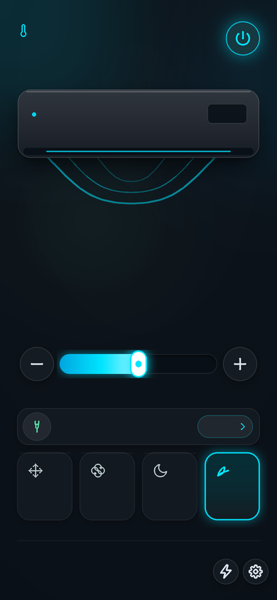
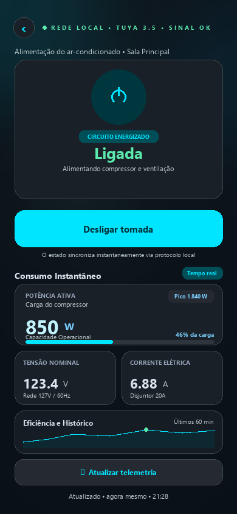

# Elgin AC Tray & Tomada EKAZA

Aplicativo desktop nativo para Windows (Python / Tkinter) que reside na bandeja do sistema (System Tray) para controle rápido do ar-condicionado **Elgin Eco Dream Inverter** e da tomada inteligente **EKAZA**, operando via rede local (LAN) com protocolo Tuya. Inclui telemetria em tempo real, controle de funções avançadas, histórico de consumo de energia com integração Tuya Cloud e persistência local SQLite.

<p align="center">
  
</p>

---

## 🌟 Principais Recursos

### ❄️ Controle do Ar-Condicionado Elgin (Comunicação LAN)
- **Liga / Desliga** com indicação visual de status e reconexão automática.
- **Ajuste de Temperatura**: Controle central de 16 °C a 32 °C com botões `+` e `−` e atalhos de teclado.
- **Modos de Operação**: Auto, Resfriar (*Cold*), Secar (*Wet*), Ventilar (*Wind*).
- **Velocidade de Ventilação**: Auto, Baixa, Média, Alta, Silencioso (*Mute*) e Turbo (*Strong*).
- **Funções Especiais**:
  - Modo **Eco** (DP 11 / Protect).
  - Modo **Dormir** (*Sleep*).
  - **Aletas** / Oscilação (*Swing*).
  - Controle do **Display** luminoso da evaporadora.
  - Modo **Mudo** e **Turbo**.
  - **Timer de Desligamento de 1 Hora** programável diretamente pelo painel.
- **Redescoberta Automática de IP**: Localiza o dispositivo pelo Device ID caso o IP na rede local sofra alteração via DHCP.

### 🔌 Telemetria e Tomada Inteligente EKAZA (LAN)
- **Acionamento Seguro**: Ligar/Desligar relé da tomada.
- **Proteção do Compressor**: Ao solicitar desligamento da tomada, o sistema consulta o estado do ar. Se o aparelho estiver ligado ou seu estado for desconhecido, solicita confirmação explícita antes do corte de energia para evitar danos ao compressor.
- **Telemetria em Tempo Real**:
  - Potência ativa instantânea em Watts (**W**).
  - Tensão elétrica em Volts (**V**).
  - Corrente elétrica em Amperes (**A**).

### ⚡ Histórico de Consumo e Estimativa de Custo
- **Tuya Cloud API**: Consulta do consumo registrado oficial nos endpoints de estatísticas (`total`, `months` e `days` em kWh).
- **Cache Local Persistido (SQLite)**: Cache das consultas em `energy_history.sqlite3`, garantindo funcionamento e histórico mesmo offline.
- **Estimativa de Consumo Local (Fallback LAN)**: Integração periódica da potência instantânea (trapézio) em segundo plano quando a nuvem não estiver disponível.
- **Custo Estimado da Fatura**: Cálculo automático em Reais (R$) com base no consumo mensal e na tarifa configurável em `config/energy_config.json` (padrão R$ 1,40/kWh).
- **Interface Gráfica Interativa**:
  - Gráfico de barras diário por mês selecionado.
  - Navegação entre meses e paginação rápida.
  - Distinção explícita entre ausência de leitura (`--`), leitura pendente e zero confirmado (`0,00`).

### 🎨 Design & Usabilidade
- Tema escuro inspirado no **Atmosphere Dark OS (Google Stitch)**.
- Janela compacta sem bordas na área de notificação que recolhe automaticamente ao clicar fora.
- Ícone dinâmico na bandeja com indicação da temperatura atual e estado ligado/desligado.
- Navegação fluida entre as 3 telas principais: **Dashboard**, **Funções** e **Tomada & Consumo**.

<p align="center">
  &nbsp;&nbsp;
  &nbsp;&nbsp;
  
</p>

---

## 📁 Estrutura do Projeto

O repositório é organizado em pastas modulares:

```text
projeto-arcondicionado/
├── config/                      # Configurações e modelos
│   ├── config.example.json      # Modelo de configuração do ar-condicionado
│   ├── plug_config.example.json # Modelo de configuração da tomada EKAZA
│   ├── tinytuya.example.json    # Modelo de integração Tuya Cloud IoT
│   ├── settings.example.json    # Modelo de preferências do aplicativo
│   ├── energy_config.json       # Tarifa e parâmetros de histórico de consumo
│   └── energy_reference.json    # Referência inicial de dados históricos
│
├── docs/                        # Documentação técnica e design
│   ├── PRODUCT.md               # Especificação de produto e requisitos
│   ├── DESIGN.md                # Diretrizes visuais e paleta de cores
│   ├── ENERGY.md                # Especificação técnica do módulo de energia
│   └── images/                  # Prévias visuais usadas neste README
│
├── src/                         # Código-fonte principal da aplicação
│   ├── elgin_tray.py            # Aplicação na bandeja (Tray) e eventos
│   ├── elgin_app.py             # Interface e bindings
│   ├── elgin_art.py             # Renderização procedural do painel em Canvas
│   ├── elgin_ac.py              # Comunicação LAN com ar-condicionado
│   ├── ekaza_plug.py            # Comunicação LAN com tomada EKAZA
│   ├── energy.py                # Cliente Tuya Cloud API
│   ├── energy_history.py        # Persistência SQLite e agregação
│   ├── energy_cost.py           # Cálculo financeiro de custo mensal
│   └── bridge.py                # Adaptador de dados
│
├── tests/                       # Suíte de 49 testes automatizados
│   ├── test_ekaza_plug.py
│   ├── test_elgin_ac.py
│   ├── test_elgin_controls.py
│   ├── test_elgin_tray.py
│   ├── test_energy_cloud.py
│   ├── test_energy_cost.py
│   └── test_energy_history.py
│
├── tools/                       # Utilitários e ferramentas auxiliares
│   ├── escanear_tuya.py         # Scanner de dispositivos Tuya na rede
│   ├── ler_status_elgin.py      # Diagnóstico e leitura de DPS do ar
│   └── render_previews.py       # Renderizador de telas de teste offline
│
├── .gitignore
├── requirements.txt
├── README.md
├── Iniciar Elgin.cmd            # Launcher facilitado para Windows
└── main.py                      # Ponto de entrada raiz
```

---

## 🛠️ Requisitos

- **Windows 10** ou **Windows 11**.
- **Python 3.10** ou superior (com suporte a Tcl/Tk incluído no instalador do Python).
- Dispositivos na mesma rede Wi-Fi / cabo local:
  - Ar-condicionado Elgin compatível com Tuya.
  - Tomada inteligente EKAZA (protocolo 3.5).

---

## 🚀 Instalação e Configuração

### 1. Clonar o repositório
```powershell
git clone git@github.com:rick1135/projeto-arcondicionado.git
cd projeto-arcondicionado
```

### 2. Criar ambiente virtual e instalar dependências
```powershell
py -m venv .venv
.\.venv\Scripts\python.exe -m pip install -r requirements.txt
```

### 3. Configurar os Dispositivos

Copie os modelos em `config/*.example.json` para criar seus arquivos de configuração na pasta `config/` (ou na raiz do projeto):

#### A. Ar-condicionado (`config/config.json`)
```json
{
  "ip": "192.168.1.100",
  "device_id": "seu_device_id_do_ar",
  "local_key": "sua_local_key_do_ar",
  "version": 3.3
}
```

#### B. Tomada EKAZA (`config/plug_config.json`)
```json
{
  "name": "tomada ar",
  "device_id": "seu_device_id_da_tomada",
  "ip": "192.168.1.101",
  "local_key": "sua_local_key_da_tomada",
  "version": "3.5"
}
```

#### C. Integração Cloud de Consumo (`config/tinytuya.json`) — *Opcional*
```json
{
  "apiKey": "sua_api_key_tuya_iot",
  "apiSecret": "seu_api_secret_tuya_iot",
  "apiRegion": "us",
  "apiDeviceID": "seu_device_id_do_ar"
}
```
*(As credenciais são geradas na plataforma Tuya IoT Cloud via wizard do TinyTuya).*

> 🔒 **Segurança**: Arquivos contendo chaves reais (`config.json`, `plug_config.json`, `tinytuya.json`, `settings.json`) e o banco `*.sqlite3` estão no `.gitignore` e nunca são enviados ao GitHub.

---

## ▶️ Como Executar

- **Pelo atalho facilitado**: Dê um duplo clique no arquivo `Iniciar Elgin.cmd`.
- **Ou pelo terminal**:
  ```powershell
  .\.venv\Scripts\pythonw.exe main.py --show
  ```

O aplicativo iniciará na área de notificação do Windows (bandeja ao lado do relógio). Um clique no ícone abre o painel.

---

## 🧪 Testes Automatizados

A suíte possui 49 testes unitários com simulação completa de hardware e mocks:

```powershell
.\.venv\Scripts\python.exe -m unittest discover -s tests -v
```

Os testes cobrem:
- Mapeamento seguro de DPS e comandos do Elgin.
- Protocolo de corte seguro da tomada (verificação prévia do ar).
- Conversão de escalas elétricas (W, V, A).
- Consultas Tuya Cloud, proteção contra vazamento de tokens e tolerância a falhas.
- Integração e persistência do histórico em SQLite.
- Cálculo de tarifa e formatação financeira brasileira.

---

## 📄 Documentação Adicional

- [docs/PRODUCT.md](docs/PRODUCT.md): Especificação de produto, limites operacionais e premissas.
- [docs/DESIGN.md](docs/DESIGN.md): Diretrizes de design, paleta de cores e comportamento visual.
- [docs/ENERGY.md](docs/ENERGY.md): Detalhamento técnico do cálculo de energia, endpoints Cloud e integração SQLite.
