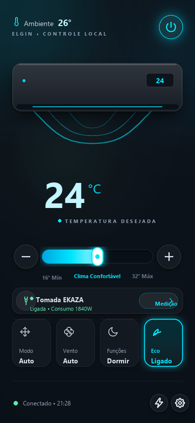
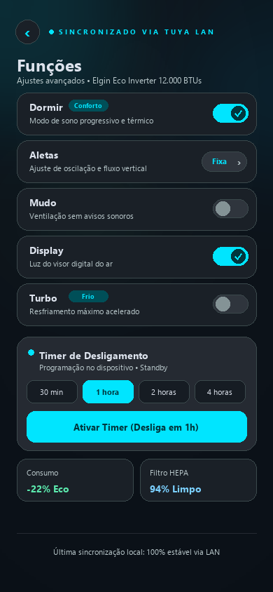
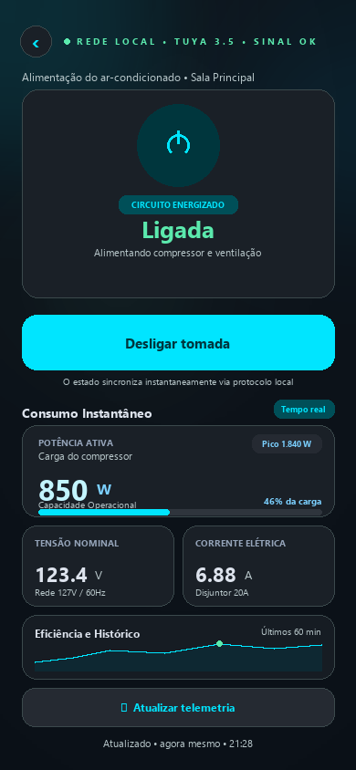

# Elgin AC Tray & Tomada EKAZA

Aplicativo desktop nativo para Windows (Python / Tkinter) que reside na bandeja do sistema (System Tray) para controle rápido do ar-condicionado **Elgin Eco Dream Inverter** e da tomada inteligente **EKAZA**, operando via rede local (LAN) com protocolo Tuya. Inclui telemetria em tempo real, controle de funções avançadas, histórico de consumo de energia com integração Tuya Cloud e persistência local SQLite.

<p align="center">
  
</p>

---

## 🌟 Principais Recursos

### ❄️ Controle do Ar-Condicionado Elgin (Comunicação LAN)
- **Liga / Desliga** com indicação visual de status e reconexão automática.
- **Ajuste de Temperatura**: Controle central de 16 °C a 32 °C com botões `+` e `−` e atalhos de teclado.
- **Modos de Operação**: Auto, Resfriar (*Cold*), Secar (*Wet*), Ventilar (*Wind*).
- **Velocidade de Ventilação**: Auto, Baixa, Média, Alta, Silencioso (*Mute*) e Turbo (*Strong*).
- **Funções Especiais**:
  - Modo **Eco** (DP 11 / Protect).
  - Modo **Dormir** (*Sleep*).
  - **Aletas** / Oscilação (*Swing*).
  - Controle do **Display** luminoso da evaporadora.
  - Modo **Mudo** e **Turbo**.
  - **Timer de Desligamento de 1 Hora** programável diretamente pelo painel.
- **Redescoberta Automática de IP**: Localiza o dispositivo pelo Device ID caso o IP na rede local sofra alteração via DHCP.

### 🔌 Telemetria e Tomada Inteligente EKAZA (LAN)
- **Acionamento Seguro**: Ligar/Desligar relé da tomada.
- **Proteção do Compressor**: Ao solicitar desligamento da tomada, o sistema consulta o estado do ar. Se o aparelho estiver ligado ou seu estado for desconhecido, solicita confirmação explícita antes do corte de energia para evitar danos ao compressor.
- **Telemetria em Tempo Real**:
  - Potência ativa instantânea em Watts (**W**).
  - Tensão elétrica em Volts (**V**).
  - Corrente elétrica em Amperes (**A**).

### ⚡ Histórico de Consumo e Estimativa de Custo
- **Tuya Cloud API**: Consulta do consumo registrado oficial nos endpoints de estatísticas (`total`, `months` e `days` em kWh).
- **Cache Local Persistido (SQLite)**: Cache das consultas em `energy_history.sqlite3`, garantindo funcionamento e histórico mesmo offline.
- **Estimativa de Consumo Local (Fallback LAN)**: Integração periódica da potência instantânea (trapézio) em segundo plano quando a nuvem não estiver disponível.
- **Custo Estimado da Fatura**: Cálculo automático em Reais (R$) com base no consumo mensal e na tarifa configurável em `energy_config.json` (padrão R$ 1,40/kWh).
- **Interface Gráfica Interativa**:
  - Gráfico de barras diário por mês selecionado.
  - Navegação entre meses e paginação rápida.
  - Distinção explícita entre ausência de leitura (`--`), leitura pendente e zero confirmado (`0,00`).

### 🎨 Design & Usabilidade
- Tema escuro inspirado no **Atmosphere Dark OS (Google Stitch)**.
- Janela compacta sem bordas na área de notificação que recolhe automaticamente ao clicar fora.
- Ícone dinâmico na bandeja com indicação da temperatura atual e estado ligado/desligado.
- Navegação fluida entre as 3 telas principais: **Dashboard**, **Funções** e **Tomada & Consumo**.

<p align="center">
  &nbsp;&nbsp;
  &nbsp;&nbsp;
  
</p>

---

## 📁 Estrutura do Projeto

| Arquivo / Pasta | Descrição |
|---|---|
| `elgin_tray.py` | Ponto de entrada da aplicação, ícone de bandeja (`pystray`) e gerenciamento das janelas e eventos. |
| `elgin_app.py` | Janela de controle e binding de atalhos e teclado. |
| `elgin_art.py` | Renderização gráfica, paleta de cores, dimensões e desenho procedural do painel em Tkinter Canvas. |
| `elgin_ac.py` | Módulo de conexão LAN e mapeamento de DPS para o ar-condicionado Elgin via TinyTuya. |
| `ekaza_plug.py` | Módulo de controle e leitura de telemetria da tomada inteligente EKAZA (protocolo 3.5). |
| `energy.py` | Cliente Tuya Cloud API para estatísticas de energia e adaptador de dados. |
| `energy_history.py` | Persistência local em SQLite (`energy_history.sqlite3`), agregação e integração de potência. |
| `energy_cost.py` | Cálculo financeiro de custo mensal estimado e formatação monetária (BRL). |
| `bridge.py` | Adaptador entre os componentes de energia, dispositivos e UI. |
| `Iniciar Elgin.cmd` | Script batch para inicialização rápida no Windows. |
| `energy_config.json` | Configuração da tarifa elétrica (R$/kWh) e parâmetros de estimativa local. |
| `energy_reference.json` | Dados de referência histórica inicial. |
| `escanear_tuya.py` | Utilitário auxiliar para escanear a rede local e identificar dispositivos Tuya. |
| `ler_status_elgin.py` | Script de diagnóstico rápido para leitura de todos os DPS do ar-condicionado. |
| `render_previews.py` | Utilitário de teste visual para inspecionar telas e fontes sem conexão à rede. |
| `stitch_smart_ac_remote_ui/` | Referências e protótipos de design de interface. |
| `test_*.py` | Suíte com 49 testes automatizados cobrindo controles, tomada, histórico e nuvem. |

---

## 🛠️ Requisitos

- **Windows 10** ou **Windows 11**.
- **Python 3.10** ou superior (com suporte nativo a Tcl/Tk incluído no instalador do Python).
- Dispositivos na mesma rede Wi-Fi / cabo local:
  - Ar-condicionado Elgin compatível com Tuya.
  - Tomada inteligente EKAZA (ou compatível com Tuya 3.5).

---

## 🚀 Instalação e Configuração

### 1. Clonar o repositório
```powershell
git clone git@github.com:rick1135/projeto-arcondicionado.git
cd projeto-arcondicionado
```

### 2. Criar ambiente virtual e instalar dependências
```powershell
py -m venv .venv
.\.venv\Scripts\python.exe -m pip install -r requirements.txt
```

### 3. Configurar os Dispositivos

O projeto utiliza arquivos JSON locais para comunicação direta via LAN (e opcionalmente Cloud Tuya). Use os arquivos `.example.json` como base:

#### A. Ar-condicionado (`config.json`)
Crie o arquivo `config.json` a partir de `config.example.json`:
```json
{
  "ip": "192.168.1.100",
  "device_id": "seu_device_id_do_ar",
  "local_key": "sua_local_key_do_ar",
  "version": 3.3
}
```

#### B. Tomada EKAZA (`plug_config.json`)
Crie o arquivo `plug_config.json` a partir de `plug_config.example.json`:
```json
{
  "name": "tomada ar",
  "device_id": "seu_device_id_da_tomada",
  "ip": "192.168.1.101",
  "local_key": "sua_local_key_da_tomada",
  "version": "3.5"
}
```

#### C. Integração Cloud de Consumo (`tinytuya.json`) — *Opcional*
Caso deseje carregar o histórico oficial de consumo acumulado registrado na Tuya Cloud:
```json
{
  "apiKey": "sua_api_key_tuya_iot",
  "apiSecret": "seu_api_secret_tuya_iot",
  "apiRegion": "us",
  "apiDeviceID": "seu_device_id_do_ar"
}
```
*(As credenciais são geradas na plataforma Tuya IoT Cloud através do assistente do TinyTuya).*

> 🔒 **Segurança**: Os arquivos `config.json`, `plug_config.json`, `tinytuya.json`, `devices.json` e o banco `*.sqlite3` estão no `.gitignore` e nunca devem ser enviados ao GitHub.

---

## ▶️ Como Executar

- **Pelo atalho facilitado**: Dê um duplo clique no arquivo `Iniciar Elgin.cmd`.
- **Ou pelo PowerShell / CMD**:
  ```powershell
  .\.venv\Scripts\pythonw.exe elgin_tray.py --show
  ```

O aplicativo iniciará diretamente no ícone da área de notificação do Windows (bandeja ao lado do relógio). Um clique no ícone abre o painel.

---

## 🧪 Testes Automatizados

O projeto conta com suíte de 49 testes unitários com simulação de hardware e mocks:

```powershell
.\.venv\Scripts\python.exe -m unittest discover -s . -p "test_*.py" -v
```

Os testes cobrem:
- Mapeamento seguro de DPS e comandos do Elgin.
- Protocolo de corte seguro da tomada (verificação prévia do ar).
- Conversão de escalas elétricas (W, V, A).
- Consultas Tuya Cloud, proteção contra vazamento de tokens e tolerância a falhas.
- Integração e persistência do histórico em SQLite.
- Cálculo de tarifa e formatação financeira brasileira.

---

## 📄 Documentação Adicional

- [PRODUCT.md](PRODUCT.md): Especificação de produto, limites operacionais e premissas.
- [DESIGN.md](DESIGN.md): Diretrizes de design, paleta de cores e comportamento visual.
- [ENERGY.md](ENERGY.md): Detalhamento técnico do cálculo de energia, endpoints Cloud e integração SQLite.
